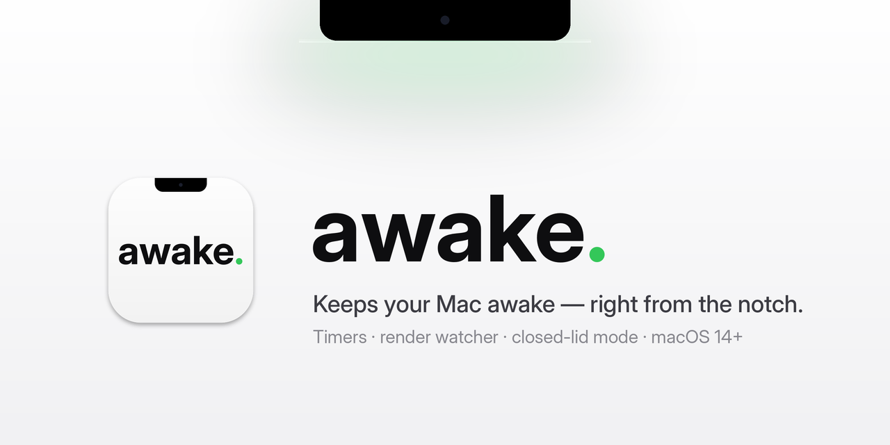

<p align="center">
  
</p>

<p align="center">
  <a href="https://github.com/morphinephotographer/awake./releases/latest"><b>Download for macOS</b></a> ·
  <a href="README.uk.md">Українська</a> ·
  <a href="README.ru.md">Русский</a>
</p>

<p align="center">
  
  
  
</p>

**awake.** is a tiny macOS app that lives in the MacBook notch and stops your Mac from falling asleep — for a set time, until a set hour, or exactly as long as your apps are rendering, exporting or downloading. No Dock icon, no menu-bar clutter: hover the notch and it opens.

## Features

- **Lives in the notch.** Hover the notch → a compact black panel grows out of it. Move away → it slides back.
- **One tap.** Big ⏻ button and presets **15m · 1h · 2h · 4h · ∞**, or *until 18:00*.
- **Render watcher.** awake. sees when Photoshop, Capture One, DaVinci Resolve, Premiere, Blender and ~60 other apps are actually working and keeps the Mac awake only for that time — then lets it sleep 2 minutes after the job is done. The app's icon appears next to the notch while it renders.
- **Knows your apps.** On first launch it finds the supported apps installed on your Mac and asks whether to follow them. Unknown apps that work hard get a “?” — one click to add them.
- **Closed-lid mode.** Keep working with the lid closed (optional helper, installed once with your admin password; turns itself off when the session ends or the battery drops to 10 %).
- **Keep the display on** or let it dim while the Mac stays awake.
- **Battery guard** — stop at 10 / 20 / 30 %.
- **Shortcuts.** ⌥⌘A toggles from anywhere, scroll over the notch adds or removes 15 minutes, ⌘Q quits while the panel is open.
- **Automation.** `awake://start?minutes=90`, `awake://until?time=18:30`, `awake://activity`, `awake://toggle`, `awake://stop` — use them in the Shortcuts app.
- **Tiny.** Native SwiftUI, no background CPU when idle, ~20–40 MB of memory.
- **Speaks your language.** English, Ukrainian and Russian — picks the macOS language automatically, or choose it in ⋯ → **Language**.

## Supported apps

| Category | Apps | Keeps the Mac awake |
|---|---|---|
| Photo | Photoshop, Lightroom, Bridge, Capture One, DxO PhotoLab, DxO PureRAW, Affinity, Pixelmator Pro, Luminar, ON1 Photo RAW, Topaz, Retouch4me, Reblum, Evoto, Aftershoot, PortraitPro, Illustrator, InDesign | while rendering / exporting |
| Video | Premiere Pro, After Effects, Media Encoder, Final Cut Pro, Compressor, Motion, iMovie, DaVinci Resolve, CapCut, HandBrake, Shutter Encoder, Filmora, ScreenFlow, Descript | while rendering / exporting |
| 3D & architecture | Blender, Cinema 4D, Houdini, Unreal Engine, Twinmotion, Lumion, D5 Render, Archicad, Rhino, SketchUp | while rendering |
| Audio | Audition, Logic Pro, GarageBand, Ableton Live, FL Studio | while bouncing / exporting |
| Development | Xcode | while building |
| Downloads | Transmission, qBittorrent, Motrix, Folx, Downie, µTorrent, JDownloader, Free Download Manager, toreo. | while downloading |
| Streaming & recording | Teleo., OBS, Ecamm Live | while open |

Every app can be switched between *render & export*, *downloads*, *while open* and *off* in ⋯ → **Apps**. Any other app can be added by hand. The list lives in [`Resources/catalog.json`](Resources/catalog.json) and is refreshed from this repository once a week — pull requests with new apps are welcome.

**How “working” is detected:** the app asks macOS not to sleep (many exporters do), or all its processes together use more than 0.6 CPU core or write more than 2 MB/s to disk (150 KB/s for download apps).

## Install

1. Download **awake-x.y.z.dmg** from [Releases](https://github.com/morphinephotographer/awake./releases/latest).
2. Open it and drag **awake.** to **Applications**.
3. The app is not notarized yet, so on first launch macOS will say it can't check it. Open **System Settings → Privacy & Security** and click **Open Anyway** (or right-click the app → **Open**).

Requires macOS 14 Sonoma or newer. Made for MacBooks with a notch; on other Macs it uses the middle of the menu bar.

## Privacy

awake. collects nothing. The only network request is a weekly download of the app catalog from this repository.

## Remove the closed-lid helper

⋯ → **More** → *Remove closed-lid helper…*, or in Terminal:

```sh
sudo launchctl bootout system/local.morphine.awake.guard
sudo rm /Library/LaunchDaemons/local.morphine.awake.guard.plist /Library/PrivilegedHelperTools/local.morphine.awake.guard
sudo pmset -a disablesleep 0
```

## Build from source

Xcode Command Line Tools and macOS 14+:

```sh
sh build.sh          # → build/awake.app
```

`Собрать и установить.command` builds, installs to /Applications and packs a zip; `tools/make_release.command` also builds the DMG and publishes a GitHub release.

---

<p align="center">Created by <b>Morphine</b></p>
