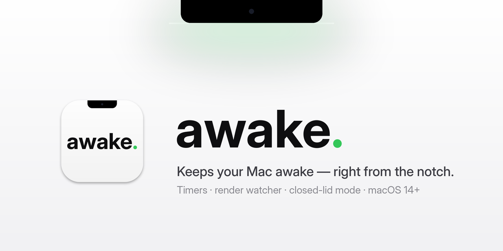

<p align="center">
  
</p>

<p align="center">
  <a href="https://github.com/morphinephotographer/awake./releases/latest"><b>Скачать для macOS</b></a> ·
  <a href="README.md">English</a> ·
  <a href="README.uk.md">Українська</a>
</p>

**awake.** — маленькое приложение для macOS, которое живёт в чёлке MacBook и не даёт Mac уснуть: на время, до нужного часа или ровно столько, сколько твои программы рендерят, экспортируют или качают. Без иконки в Dock и без лишнего в строке меню — наведи курсор на чёлку, и она раскроется.

## Возможности

- **Живёт в чёлке.** Навёл на чёлку — из неё вырастает компактная чёрная панель. Увёл курсор — она прячется обратно.
- **Одно нажатие.** Большая кнопка ⏻ и время **15м · 1ч · 2ч · 4ч · ∞** или *до 18:00*.
- **Слежение за рендером.** awake. видит, когда Photoshop, Capture One, DaVinci Resolve, Premiere, Blender и ещё ~70 программ действительно работают, и держит Mac бодрым только это время, а через 2 минуты после окончания отпускает сон. Пока идёт рендер, иконка программы видна рядом с чёлкой.
- **ИИ-агенты.** Claude Code, Codex CLI, Gemini CLI, Aider и другие агенты в Терминале, а также приложения Claude, ChatGPT и Cursor: Mac не уснёт, пока агент выполняет задачу, даже если он «думает» на сервере, а Мак почти простаивает (3 минуты запаса).
- **Знает твои программы.** При первом запуске находит установленные программы из списка и спрашивает, следить ли за ними. Если незнакомая программа долго нагружает Mac — появится «?», и её можно добавить одним кликом.
- **Работа с закрытой крышкой** — по желанию, помощник ставится один раз с паролем администратора и сам выключается, когда сеанс закончился или заряд упал до 10 %.
- **Экран** — не гаснет или может погаснуть, пока Mac не спит.
- **Защита батареи** — выключаться при 10 / 20 / 30 %.
- **Горячие клавиши.** ⌥⌘A — включить/выключить откуда угодно, колёсико над чёлкой — ±15 минут, ⌘Q на открытой панели — выйти.
- **Автоматизация.** `awake://start?minutes=90`, `awake://until?time=18:30`, `awake://activity`, `awake://toggle`, `awake://stop` — для приложения «Быстрые команды».
- **Говорит на твоём языке.** Английский, украинский и русский — язык берётся из macOS автоматически или выбирается в ⋯ → **Язык**.
- **Лёгкое.** Нативный SwiftUI, в простое не нагружает процессор, 20–40 МБ памяти.

## Поддерживаемые программы

| Категория | Программы | Mac не спит |
|---|---|---|
| Фото | Photoshop, Lightroom, Bridge, Capture One, DxO PhotoLab, DxO PureRAW, Affinity, Pixelmator Pro, Luminar, ON1 Photo RAW, Topaz, Retouch4me, Reblum, Evoto, Aftershoot, PortraitPro, Illustrator, InDesign | пока рендерит / экспортирует |
| Видео | Premiere Pro, After Effects, Media Encoder, Final Cut Pro, Compressor, Motion, iMovie, DaVinci Resolve, CapCut, HandBrake, Shutter Encoder, Filmora, ScreenFlow, Descript | пока рендерит / экспортирует |
| 3D и архитектура | Blender, Cinema 4D, Houdini, Unreal Engine, Twinmotion, Lumion, D5 Render, Archicad, Rhino, SketchUp | пока рендерит |
| Звук | Audition, Logic Pro, GarageBand, Ableton Live, FL Studio | пока сводит / экспортирует |
| Разработка | Xcode | пока собирает |
| ИИ-агенты | Claude Code, Codex CLI, Gemini CLI, Aider, OpenCode, Cursor Agent, Copilot CLI, Grok CLI, Claude, ChatGPT, Cursor | пока агент работает (и в Терминале) |
| Загрузки | Transmission, qBittorrent, Motrix, Folx, Downie, µTorrent, JDownloader, Free Download Manager, toreo. | пока качает |
| Стримы и запись | Teleo., OBS, Ecamm Live | пока открыта |

Для каждой программы режим меняется в ⋯ → **Программы**: рендер и экспорт, загрузка, пока открыта или не следить. Любую другую программу можно добавить вручную. Список лежит в [`Resources/catalog.json`](Resources/catalog.json) и раз в неделю обновляется из этого репозитория — присылай pull request с новыми программами.

**Как awake. понимает, что программа работает:** она сама просит macOS не засыпать (так делают многие экспортёры) или все её процессы вместе берут больше 0,6 ядра процессора или пишут на диск быстрее 2 МБ/с (150 КБ/с для качалок).

## Установка

1. Скачай **awake-x.y.z.dmg** в [Releases](https://github.com/morphinephotographer/awake./releases/latest).
2. Открой и перетащи **awake.** в **Программы**.
3. Приложение пока не нотаризовано, поэтому при первом запуске macOS скажет, что не может его проверить. Открой **Системные настройки → Конфиденциальность и безопасность** и нажми **Всё равно открыть** (или правый клик по приложению → **Открыть**).

Нужна macOS 14 Sonoma или новее. Сделано для MacBook с чёлкой; на других Mac панель живёт посередине строки меню.

## Приватность

awake. ничего не собирает. Единственный запрос в сеть — раз в неделю скачать список программ из этого репозитория.

## Удалить помощник закрытой крышки

⋯ → **Ещё** → *Удалить помощник закрытой крышки…* или в Терминале:

```sh
sudo launchctl bootout system/local.morphine.awake.guard
sudo rm /Library/LaunchDaemons/local.morphine.awake.guard.plist /Library/PrivilegedHelperTools/local.morphine.awake.guard
sudo pmset -a disablesleep 0
```

## Сборка из исходников

Нужны Xcode Command Line Tools и macOS 14+:

```sh
sh build.sh          # → build/awake.app
```

`Собрать и установить.command` собирает, ставит в «Программы» и упаковывает zip; `tools/make_release.command` ещё и делает DMG и публикует релиз на GitHub.

---

<p align="center">Создано <b>Morphine</b></p>
