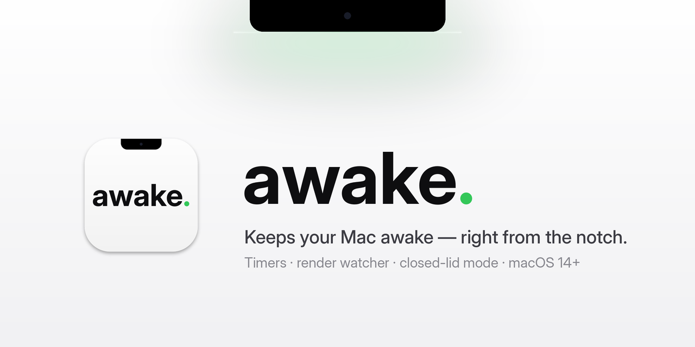

<p align="center">
  
</p>

<p align="center">
  <a href="https://github.com/morphinephotographer/awake./releases/latest"><b>Завантажити для macOS</b></a> ·
  <a href="README.md">English</a> ·
  <a href="README.ru.md">Русский</a>
</p>

**awake.** — маленька програма для macOS, яка живе у вирізі екрана MacBook і не дає Mac заснути: на певний час, до потрібної години або рівно стільки, скільки твої програми рендерять, експортують чи завантажують. Без іконки в Dock і без зайвого в рядку меню — наведи курсор на виріз, і він розкриється.

## Можливості

- **Живе у вирізі.** Навів курсор — з вирізу виростає компактна чорна панель. Відвів — вона ховається назад.
- **Одне натискання.** Велика кнопка ⏻ і час **15хв · 1год · 2год · 4год · ∞** або *до 18:00*.
- **Стеження за рендером.** awake. бачить, коли Photoshop, Capture One, DaVinci Resolve, Premiere, Blender і ще ~60 програм справді працюють, і тримає Mac бадьорим лише цей час, а через 2 хвилини після завершення відпускає сон. Поки триває рендер, іконка програми видна поруч із вирізом.
- **Знає твої програми.** Під час першого запуску знаходить встановлені програми зі списку й питає, чи стежити за ними. Якщо незнайома програма довго навантажує Mac — з'явиться «?», і її можна додати одним кліком.
- **Робота із закритою кришкою** — за бажанням: помічник встановлюється один раз із паролем адміністратора й сам вимикається, коли сеанс завершився або заряд упав до 10 %.
- **Екран** — не гасне або може згаснути, поки Mac не спить.
- **Захист батареї** — вимикатися при 10 / 20 / 30 %.
- **Гарячі клавіші.** ⌥⌘A — увімкнути/вимкнути звідусіль, коліщатко над вирізом — ±15 хвилин, ⌘Q на відкритій панелі — вийти.
- **Автоматизація.** `awake://start?minutes=90`, `awake://until?time=18:30`, `awake://activity`, `awake://toggle`, `awake://stop` — для програми «Швидкі команди».
- **Розмовляє твоєю мовою.** Англійська, українська й російська — мова береться з macOS автоматично або обирається в ⋯ → **Мова**.
- **Легка.** Нативний SwiftUI, у простої не навантажує процесор, 20–40 МБ пам'яті.

## Підтримувані програми

| Категорія | Програми | Mac не спить |
|---|---|---|
| Фото | Photoshop, Lightroom, Bridge, Illustrator, InDesign, Capture One, DxO PhotoLab, DxO PureRAW, Affinity, Pixelmator Pro, Luminar, ON1 Photo RAW, Topaz, Retouch4me, Reblum, Evoto, Aftershoot, PortraitPro | поки рендерить / експортує |
| Відео | Premiere Pro, After Effects, Media Encoder, Final Cut Pro, Compressor, Motion, iMovie, DaVinci Resolve, CapCut, HandBrake, Shutter Encoder, Filmora, ScreenFlow, Descript | поки рендерить / експортує |
| 3D та архітектура | Blender, Cinema 4D, Houdini, Unreal Engine, Twinmotion, Lumion, D5 Render, Archicad, Rhino, SketchUp | поки рендерить |
| Звук | Audition, Logic Pro, GarageBand, Ableton Live, FL Studio | поки зводить / експортує |
| Розробка | Xcode | поки збирає |
| Завантаження | Transmission, qBittorrent, Motrix, Folx, Downie, µTorrent, JDownloader, Free Download Manager, toreo. | поки завантажує |
| Стріми й запис | Teleo., OBS, Ecamm Live | поки відкрита |

Для кожної програми режим змінюється в ⋯ → **Програми**: рендер і експорт, завантаження, поки відкрита або не стежити. Будь-яку іншу програму можна додати вручну. Список лежить у [`Resources/catalog.json`](Resources/catalog.json) і раз на тиждень оновлюється з цього репозиторію — надсилай pull request з новими програмами.

**Як awake. розуміє, що програма працює:** вона сама просить macOS не засинати (так роблять багато експортерів) або всі її процеси разом беруть понад 0,6 ядра процесора чи пишуть на диск швидше за 2 МБ/с (150 КБ/с для завантажувачів).

## Встановлення

1. Завантаж **awake-x.y.z.dmg** у [Releases](https://github.com/morphinephotographer/awake./releases/latest).
2. Відкрий і перетягни **awake.** у **Програми**.
3. Програма поки не нотаризована, тож під час першого запуску macOS скаже, що не може її перевірити. Відкрий **Системні параметри → Приватність і безпека** й натисни **Усе одно відкрити** (або правий клік по програмі → **Відкрити**).

Потрібна macOS 14 Sonoma або новіша. Зроблено для MacBook із вирізом екрана; на інших Mac панель живе посередині рядка меню.

## Приватність

awake. нічого не збирає. Єдиний запит у мережу — раз на тиждень завантажити список програм із цього репозиторію.

## Видалити помічник закритої кришки

⋯ → **Ще** → *Видалити помічник закритої кришки…* або в Терміналі:

```sh
sudo launchctl bootout system/local.morphine.awake.guard
sudo rm /Library/LaunchDaemons/local.morphine.awake.guard.plist /Library/PrivilegedHelperTools/local.morphine.awake.guard
sudo pmset -a disablesleep 0
```

## Збирання з вихідного коду

Потрібні Xcode Command Line Tools і macOS 14+:

```sh
sh build.sh          # → build/awake.app
```

`Собрать и установить.command` збирає, встановлює в «Програми» й пакує zip; `tools/make_release.command` ще й робить DMG і публікує реліз на GitHub.

---

<p align="center">Створено <b>Morphine</b></p>
